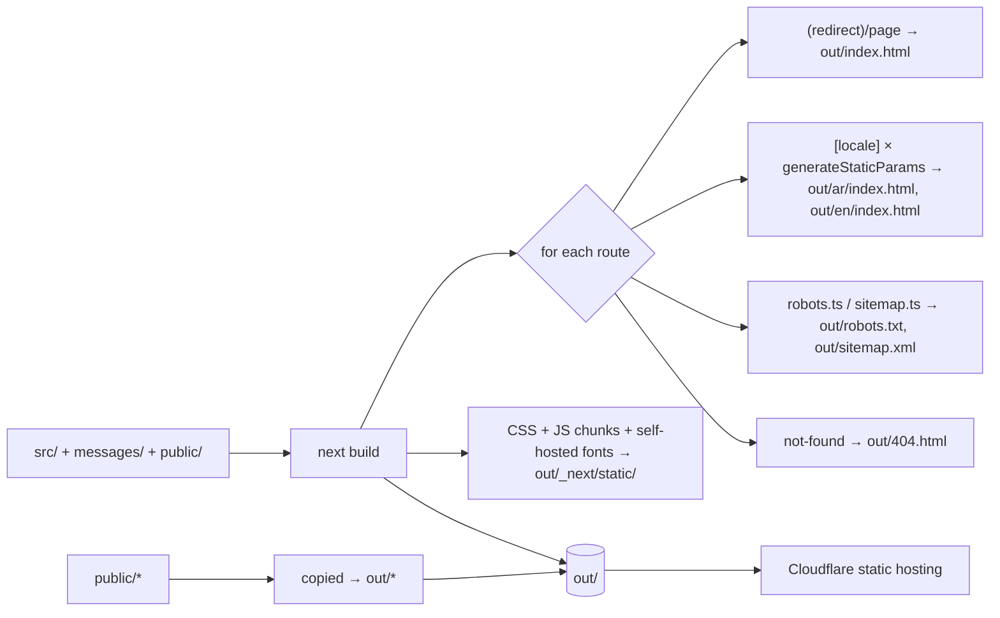
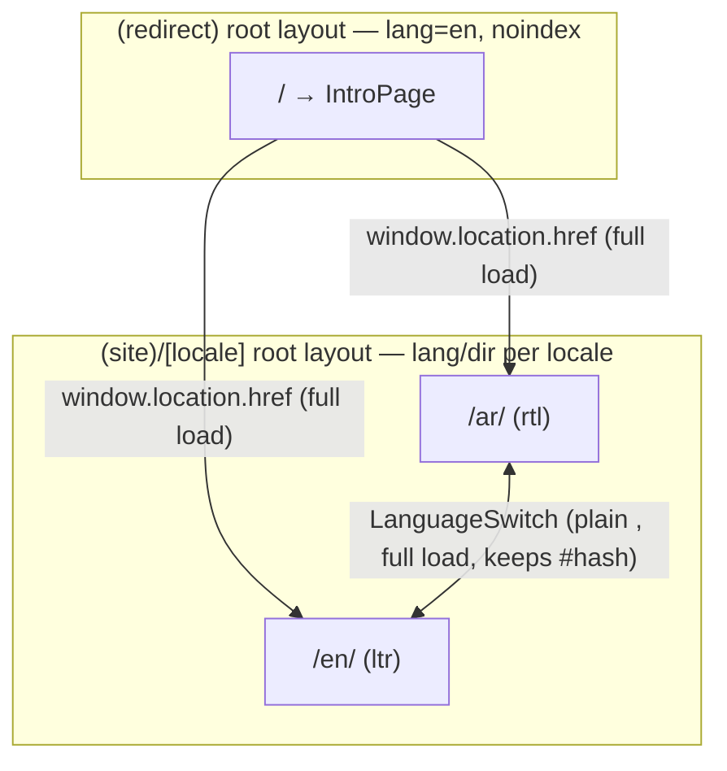
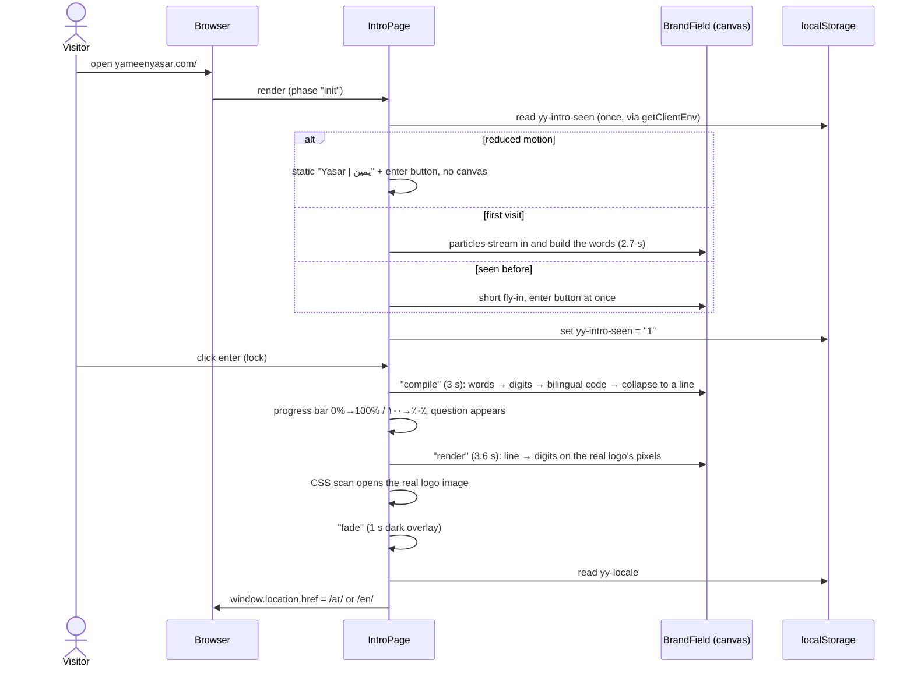
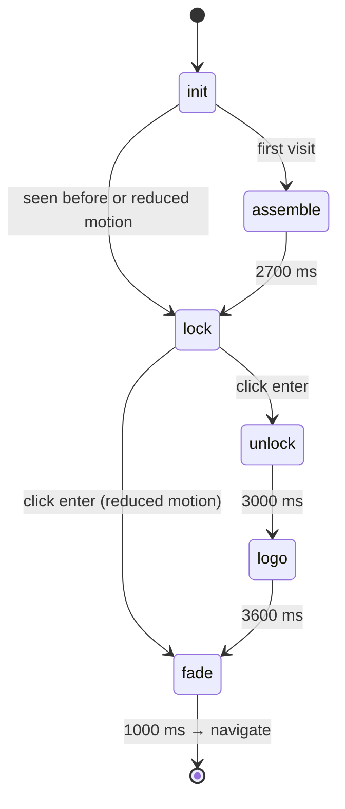
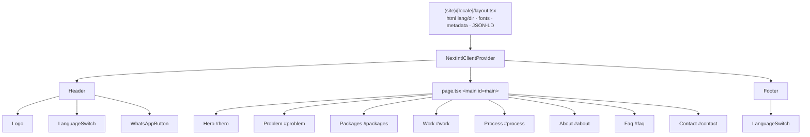
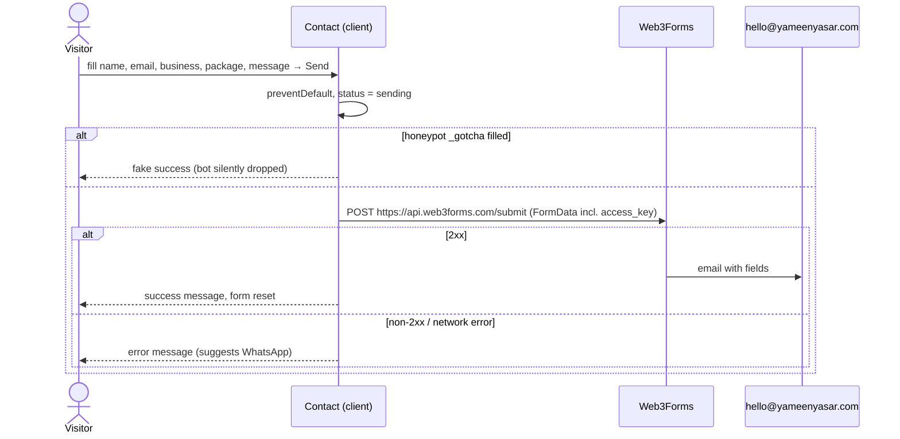

# Architecture — Yameen Yasar Studio website

This document explains how the `yameenyasar.com` site is built and how its parts fit together. For day-to-day rules (what to do and not do when editing), see `CLAUDE.md`.

## 1. What the system is

A **fully static, bilingual (Arabic/English) marketing site** for a one-person web studio. It has no server, no database and no API of its own. At build time Next.js renders every page to plain HTML/CSS/JS in `out/`, and Cloudflare serves those files. The only runtime integrations are browser-side:

- **Web3Forms** receives contact-form submissions and emails them to the studio.
- **WhatsApp** (`wa.me` deep links) is the primary call to action.
- **localStorage** remembers the visitor's language and whether they have seen the intro.

The site has three pages:

| URL | Purpose | Indexed |
| --- | --- | --- |
| `/` | Cinematic intro. It shows the brand, asks one question, then sends the visitor to their language. | No (`noindex, follow`) |
| `/ar/` | Full one-page site in Arabic, RTL. This is the default locale. | Yes |
| `/en/` | The same site in English, LTR. | Yes |
| `/404.html` | Next.js not-found page | — |

## 2. System context

```mermaid
flowchart LR
  V[Visitor's browser] -->|HTTPS GET static files| CF[Cloudflare<br/>yameenyasar.com<br/>serves out/]
  V -->|POST FormData| W3F[Web3Forms API<br/>api.web3forms.com/submit]
  W3F -->|email| INBOX[hello@yameenyasar.com]
  V -->|opens link| WA[WhatsApp<br/>wa.me/&lt;number&gt;?text=…]
  V -->|outbound links| SOC[Instagram / LinkedIn]

  subgraph Build time only
    DEV[Developer machine<br/>or CI] -->|next build| OUT[out/ static files]
    DEV -.->|downloads fonts once| GF[Google Fonts]
    OUT -->|deploy| CF
  end
```

Google Fonts is contacted **only at build time**. `next/font/google` downloads the font files and self-hosts them under `/_next/static/media/`, so visitors' browsers never call Google. A side effect is that the build fails without internet access.

## 3. Technology stack

| Concern | Technology | Version | Notes |
| --- | --- | --- | --- |
| Framework | Next.js App Router | 16.3.6 | `output: "export"`, `trailingSlash: true`, `images.unoptimized: true` |
| UI runtime | React / React DOM | 19.2.8 | Mostly Server Components rendered at build time |
| Language | TypeScript (strict) | ^5 | Path alias `@/*` → `src/*` |
| i18n | next-intl | 4.14.6 | No middleware. Locale comes from the `[locale]` segment |
| CSS | Tailwind CSS v4 + `@tailwindcss/postcss` | 4.3.x | Configured in CSS (`@theme inline`). There is no JS config file |
| Icons | lucide-react | 1.47.0 | `Menu`, `X` only |
| Fonts | next/font/google | — | Readex Pro, Cormorant Garamond, Tajawal |
| Forms | Web3Forms | SaaS | Public access key via `NEXT_PUBLIC_WEB3FORMS_KEY` |
| Lint | ESLint 9 flat config + eslint-config-next 16.3.6 | ^9 | core-web-vitals + typescript presets |
| Dev-only | puppeteer-core | ^25 | Used ad hoc during development; no committed script |
| Hosting | Cloudflare (Workers & Pages) | — | Static assets only |
| Runtime requirement | Node.js | ≥ 20.9 | From Next 16's `engines` field |

## 4. Repository layout

```
website/
├── src/
│   ├── app/
│   │   ├── (redirect)/              # Route group → root layout for "/"
│   │   │   ├── layout.tsx           #   <html lang="en">, fonts, noindex metadata, favicon
│   │   │   ├── page.tsx             #   <IntroPage/> + <noscript> fallback
│   │   │   └── intro.css            #   intro-only styles (layer stack, lock, video, fade)
│   │   ├── (site)/[locale]/         # Route group → root layout for "/ar/" and "/en/"
│   │   │   ├── layout.tsx           #   <html lang dir>, fonts, metadata, JSON-LD, Header/Footer, i18n provider
│   │   │   └── page.tsx             #   composes the 8 sections
│   │   ├── globals.css              # tokens, type scale, RTL base, logo + hero animations
│   │   ├── robots.ts                # → out/robots.txt
│   │   └── sitemap.ts               # → out/sitemap.xml
│   ├── components/
│   │   ├── IntroPage.tsx            # client component: intro state machine
│   │   ├── Header.tsx               # client component: sticky header + mobile menu
│   │   ├── Footer.tsx
│   │   ├── sections/                # Hero, Problem, Packages, Work, Process, About, Faq, Contact
│   │   └── ui/                      # Logo, LanguageSwitch, WhatsAppButton
│   ├── i18n/
│   │   ├── routing.ts               # locales + default locale
│   │   └── request.ts               # per-request (per-build-page) locale + messages loader
│   └── lib/
│       └── site.ts                  # site constants + whatsappUrl()
├── messages/
│   ├── ar.json                      # Arabic strings (Modern Standard Arabic)
│   └── en.json                      # English strings (same key tree)
├── public/                          # copied verbatim into out/
│   ├── brand/                       # logos + favicon
│   ├── images/                      # anan.jpg, intro/hero videos, unused leftovers
│   ├── og-ar.png, og-en.png         # Open Graph cards
│   └── favicon.ico, favicon.png     # root fallbacks for browsers that request /favicon.*
├── docs/website-copy.md             # original copy brief (partly stale, see §14)
├── assets/                          # raw inputs from Anan (not served)
├── .agents/skills/ + .claude/skills/  # Higgsfield asset-generation skills (tooling, not app code)
├── next.config.ts                   # static export + next-intl plugin
├── postcss.config.mjs, eslint.config.mjs, tsconfig.json
├── .env.local                       # NEXT_PUBLIC_WEB3FORMS_KEY (git-ignored)
└── out/                             # build output (git-ignored) — the deployable site
```

Local leftovers that are **not** part of the architecture: `.open-next/` and `.wrangler/` (from a one-off OpenNext/wrangler experiment on 2026-10-01), `.next/` (build cache), `tsconfig.tsbuildinfo`, `.DS_Store`, and Finder duplicates such as `out/en 3/`.

## 5. Build and deploy pipeline



Key points:

- **Static export means no server code at request time.** Anything in Server Components runs once during `next build`. Middleware, rewrites, redirects, ISR, `next/image` optimisation and API routes are unavailable. `robots.ts` and `sitemap.ts` declare `export const dynamic = "force-static"` for this reason.
- **`trailingSlash: true`** makes Next emit `ar/index.html` instead of `ar.html`. Every internal link uses the trailing slash (`/ar/`, `/en/`).
- **next-intl plugin** (`createNextIntlPlugin("./src/i18n/request.ts")`) wires the request config into the build.
- **Environment variables**: `NEXT_PUBLIC_WEB3FORMS_KEY` is inlined into the client JS during the build. The value present in the build environment decides whether the contact form exists in the output.
- **Deploy**: upload or serve `out/`. Build command `npm run build`, output dir `out`. The repo contains no CI workflow or `wrangler` config, so the deploy is either Cloudflare's Git integration or a manual `npx wrangler pages deploy out`.

## 6. Routing design: two root layouts

The app has **no** `src/app/layout.tsx`. Instead, two route groups each define their own root layout with its own `<html>`:



Why it is built this way:

- The intro needs a completely different document: no header/footer, a fixed full-screen stage, its own CSS, and both languages at once. Keeping it in its own root layout means none of that leaks into the main site, and `intro.css` only loads on `/`.
- `<html lang dir>` must be correct in the static HTML for RTL to render properly before JS runs. A per-locale root layout lets the server output `dir="rtl"` directly.
- Navigation between root layouts is always a full page load in Next.js. The code embraces that by using `window.location.href` and plain `<a>` tags instead of the router.

## 7. Visitor flow

### 7.1 First visit to `/`



Locale detection (`detectLocale()`): use the saved `yy-locale` if it is `ar` or `en`. Otherwise use `/ar/` when `navigator.language` starts with `ar`, and `/en/` for everything else.

**Skip button** (top right, "Skip / تخطّي"): sets `yy-intro-seen` and navigates immediately.

**No JavaScript**: a `<noscript>` block hides the intro container, shows links to both languages, and `<meta http-equiv="refresh">` sends the visitor to `/ar/`.

### 7.2 On the locale page

The visitor scrolls through one page. Anchor links in the header jump to sections. Conversion happens through one of three paths: a WhatsApp button (header, hero, contact), the contact form, or the `mailto:` link (contact fallback, footer).

## 8. Intro page internals (`components/IntroPage.tsx` + `intro.css` + `lib/brandField.ts`)

The concept is the name: «يمين» means right and "Yasar" (يسار) means left. Crimson particles come in from the right edge and build «يمين» on the right half; silver particles come in from the left and build "Yasar" on the left half. After the click, the words are "compiled" like a program and the result is the logo.

### 8.1 State machine



`init` exists only for the server render. The starting phase is derived from `getClientEnv()` (returning visitor? reduced motion?), which is read once through `useSyncExternalStore` with a module-level cache, so no `setState` runs inside an effect. The phase is also put on `.intro-root` as a class (`phase-lock`, `phase-logo`, …), and most of the CSS keys off it.

Each phase's effect schedules **only its own** next timeout. An earlier version scheduled all of them in one effect, and React's cleanup cancelled the later timers as soon as the phase changed.

### 8.2 The particle engine (`BrandField`)

Plain canvas 2D, no dependencies, one `requestAnimationFrame` loop. React only tells it the mode (`form` → `compile` → `render`) and the pointer position; it never re-renders per frame.

| Mode | When | What happens |
| --- | --- | --- |
| `form` | `assemble`, `lock` | Target points are sampled from «يمين» (Tajawal 700) and "Yasar" (Cormorant 600) drawn on an offscreen canvas, so the shapes come from the real fonts and the Arabic stays joined. Particles fly in on curved paths (the two scripts curve in opposite directions and braid), shimmer in place, and are pushed away by the pointer. A thin light seam appears between the words. If the fonts arrive after the 1.5 s timeout, the targets are re-sampled and the particles glide into the right shapes. |
| `compile` | `unlock` (3 s) | 0 s: two beams sweep out from the seam and turn particles into flickering glyphs. 0.35 s: glyphs fly into an editor and type themselves out: real LTR code about RTL on the left, right-aligned rows of Arabic-Indic numbers typed right-to-left on the right (portrait: stacked). Leftover particles fall into the progress bar. 1.95 s: a scan line runs down the code. 2.45 s: everything collapses into one horizontal line at mid-height. Timings: `T_TYPE`, `T_COMPILE`, `T_COLLAPSE`. |
| `render` | `logo` | The line's particles are sorted left→right and mapped onto points sampled from `public/brand/yy-logo-intro.png`, so the line opens vertically into the logo, written in crimson and silver digits matching the logo's colours. At `T_OPEN` (0.95 s) the real logo image is opened by a CSS `clip-path` scan over `D_OPEN` (0.8 s); digits inside the opened band dissolve. Spare particles fly off sideways. |

Each particle in the code phase shows exactly one character, so the Arabic side uses **digits only**. Arabic letters are never drawn one per cell, because they would show up un-joined.

Glyphs are pre-rendered once per character and colour (silver, crimson, hot white) into small canvases with a glow, then drawn with `drawImage`. The previous frame is faded with `destination-out` instead of cleared, which gives the short light trails.

### 8.3 Visual layer stack (bottom → top)

| Layer | What it is |
| --- | --- |
| `.intro-ambient` | `ambient-silk.mp4` loop (same file as the hero, so it is cached), opacity driven by phase |
| `.intro-grid` | Faint crimson blueprint grid, visible only during `unlock` |
| `.intro-logo` | The real logo ``, hidden until `logo`, then opened by the clip-path scan; crimson drop-shadow, backlight and one masked light sweep |
| `.intro-canvas` | The `BrandField` canvas |
| `.intro-static-brand` | Reduced motion only: the two words as plain text |
| `.intro-stage` | Enter button (rotating two-colour ring, halos, slight magnetic pull toward the mouse) and, after the click, the progress bar and the question (words sharpen out of a blur one by one; the Arabic line breaks after the comma) |
| `.intro-noise`, `.intro-vignette` | Grain and darkened edges |
| `.intro-skip` | Skip button (physical top-right: the page is direction-neutral) |
| `.intro-fade-out` | 1 s fade to `#0B0B0B` before navigation |

### 8.4 Rules that keep it working

- `.intro-logo`'s size (`min(60vw, 880px)`, `84vw` in portrait, centred) must equal `BrandField.logoWidth()`, and its clip animation must match `T_OPEN` / `D_OPEN` and the band in `stepRender`. Otherwise the digits and the image don't line up.
- The finale shows the real logo file. An earlier version used an AI-generated reveal video, which redrew the logo slightly wrong and dimmer; it was removed on 2026-10-11.
- Skip works in every phase, and every phase after `lock` ends on a timer, so a visitor can never get stuck.
- There is no reveal video any more, so the old iOS autoplay rules (call `play()` inside the click, never `load()`/`pause()`) only matter again if a video is added back.

## 9. Locale pages

### 9.1 Composition



### 9.2 Server vs client components

| Component | Kind | Why |
| --- | --- | --- |
| Locale layout, page, Hero, Problem, Packages, Work, Process, About, Faq, Footer | Server (rendered at build) | Pure markup from translations; ships no component JS |
| `Header` | Client (`"use client"`) | Scroll state (border after 8px), mobile menu toggle, Escape to close |
| `Logo`, `WhatsAppButton` | Client by import | No directive, but imported into `Header`, so they are bundled as client code there |
| `LanguageSwitch` | Client | Reads `location.hash` and writes `localStorage` on click |
| `Contact` | Client | Form state machine and `fetch` |
| `IntroPage` | Client | Canvas, timers, video, localStorage |

`NextIntlClientProvider` receives **all** messages for the locale, so the full translation JSON for that locale is embedded in each page for client components to use. That is a few KB and acceptable at this size.

### 9.3 Sections

| Section | Background | Message namespace | Notes |
| --- | --- | --- | --- |
| Hero | `bg` + `ambient-silk.mp4` (85%, feathered top) + `HeroFx` floating letters + mouse spotlight | `hero`, `whatsapp` | Current-locale headline (words rise out of a blur in reading order; screen readers get the sentence once) plus the other locale's headline with its own `lang`/`dir`, arriving from the opposite side; a line draws itself from the reading side |
| Problem | `paper` | `problem` | 3 cards (`card1..3Title/Body`) and a closing line |
| Packages | `bg` | `packages` | Launch-offer banner (if `site.launchOffer`), 3 tiers `launch` / `business` / `custom`, features via `t.raw()`, 2 add-ons |
| Work | `surface` | `work` | 3 concept cards (`onlineStore`, `clinic`, `saas`), image area shows "Coming soon" |
| Process | `bg` | `process` | Numbered `<ol>` of 4 steps and a payment-terms line |
| About | `surface` | `about` | `/images/anan.jpg`, headline, bio, closing line |
| FAQ | `paper` | `faq` | 6 native `<details>/<summary>` items, no JS |
| Contact | `surface` | `contact`, `whatsapp` | Web3Forms form, or a WhatsApp/email fallback when there is no key |

## 10. Internationalisation

### 10.1 Configuration

- `i18n/routing.ts`: `locales: ["ar", "en"]`, `defaultLocale: "ar"`.
- `i18n/request.ts`: resolves the locale (falls back to `ar` if invalid) and dynamically imports `messages/<locale>.json`.
- The locale layout's `generateStaticParams` returns both locales, so both pages are prerendered. `setRequestLocale(locale)` in the layout and the page lets next-intl work during static rendering without middleware or headers.
- Server components use `useTranslations` / `getTranslations` at build time. Client components get the same API through `NextIntlClientProvider`.

### 10.2 Message structure

Both files share the same key tree (verified):

```
meta{title,description} · nav{packages,work,about,contact}
header{skipToContent,menu,whatsapp,logoAlt} · languageSwitch{label} · whatsapp{prefilled}
hero{headline,subline,ctaWhatsapp,ctaPackages,otherHeadline}
problem{headline,card1Title..card3Body,closing}
packages{headline,launchOffer,launch|business|custom{name,price,duration,[badge],features[]},addons{title,monthlyCare|copywriting{name,price,description}}}
work{headline,viewSite,comingSoon,onlineStore|clinic|saas{name,tag,description}}
process{headline,step1Title..step4Body,payment}
about{headline,bio,closing}
faq{headline,q1..q6,a1..a6}
contact{headline,subline,field*,package*,send,whatsapp,success,error}
footer{tagline,copyright,logoAlt}
```

Components iterate fixed key lists (`TIERS`, `CARDS`, `STEPS`, `QUESTIONS`, `PROJECTS`, `PACKAGE_OPTIONS`, `NAV_ITEMS`). Adding an item means updating the list **and** both JSON files.

The Arabic copy is polished Modern Standard Arabic with a warm tone. It was rewritten from the Levantine colloquial in `docs/website-copy.md` on 2026-10-04 (commit `4d46749`).

### 10.3 Direction handling

- `dir` on `<html>` drives everything: Tailwind logical utilities (`ms-`, `me-`, `inset-inline-start`), CSS logical properties, and direction-aware CSS variables:
  - `--font-heading-family` → Cormorant Garamond in LTR, Tajawal under `[dir="rtl"]`.
  - `--hero-from-start` / `--hero-from-end` flip the hero slide-in directions.
- Inline islands of the other direction are marked explicitly: the hero's other-language headline (`lang` + `dir`), emails (`dir="ltr"`), the email input, and the logo (`dir="ltr"`).
- `[dir="rtl"]` sets `letter-spacing: 0`, body line-height 1.75 and heading line-height 1.35.

### 10.4 Persistence

| Key | Written by | Read by | Effect |
| --- | --- | --- | --- |
| `yy-locale` | `LanguageSwitch` click | `IntroPage.detectLocale()` | Overrides browser language on the next visit to `/` |
| `yy-intro-seen` | `IntroPage` on reaching `lock`, on unlock, on skip | `IntroPage` on mount | Returning visitors skip straight to the lock |

All storage access is wrapped in `try/catch`, so private mode or blocked storage degrades gracefully.

## 11. Styling system

- **Tailwind v4, CSS-first.** `globals.css` does `@import "tailwindcss"`, defines raw CSS variables on `:root`, then maps them with `@theme inline` into Tailwind's namespaces. That produces `bg-bg`, `text-text`, `text-text-muted`, `bg-surface`, `border-line`, `bg-crimson`, `text-crimson-bright`, `bg-paper`, `font-sans`, `font-heading`, and `text-display|h1|h2|body|small|label` (each with a paired line-height).
- **Palette** (dark-only): bg `#0B0B0B`, surface `#151313`, line `#2A2424`, text `#F5F2ED`, text-muted `#A3A09B`, crimson `#8B0D1A` (fills), crimson-bright `#E5484D` (text on dark, focus ring), paper `#F5F2ED` (light sections).
- **Fonts**: three `next/font/google` instances expose CSS variables (`--font-readex-pro`, `--font-cormorant`, `--font-tajawal`) on `<html>`. Both root layouts declare the same three fonts so the intro and the site share them.
- **Global behaviours**: 2px crimson-bright `:focus-visible` ring with 2px offset, and a skip-to-content link that is off-screen until focused (logical `inset-inline-start`).

Animation inventory (all disabled or neutralised under `prefers-reduced-motion`, except the intro canvas):

| Where | Animation | Mechanism |
| --- | --- | --- |
| Header logo | Clip-path reveal (mark first, then wordmark), crimson breathing glow every 4 s, light gleam every 8 s | CSS keyframes on `.logo-reveal`, `.logo-glow::before`, `.logo-gleam-bar::before` |
| Hero | Word-by-word headline entrance, other headline from the opposite side, self-drawing line, CTA light sweep on hover; floating Arabic/Latin letters with pointer parallax (paused off-screen); mouse spotlight; text lifts and fades on scroll | CSS keyframes, `HeroFx` canvas + CSS variables, CSS scroll-driven animation (`animation-timeline: scroll()`), `<video autoplay muted loop playsInline>` |
| Intro | Particle words, enter button, compile transition (digits → code → line), bilingual progress bar, real-logo finale | `BrandField` canvas + rAF, phase classes + CSS transitions/keyframes |

## 12. Contact form flow



- Required fields: name, email (`type="email"`, `dir="ltr"`), message. Business and package are optional. The package `<option>` values are the **translated labels**, so submissions from `/ar/` arrive with Arabic package names.
- Without `NEXT_PUBLIC_WEB3FORMS_KEY` at build time, the section renders only the WhatsApp button and the email address.
- The Web3Forms access key is designed to be public: it is visible in the HTML and only allows sending to the account's own inbox.

## 13. SEO

| Item | Source | Output |
| --- | --- | --- |
| `<title>` and meta description | `meta.title` / `meta.description` per locale | Locale pages |
| Canonical | `generateMetadata` | `https://yameenyasar.com/{locale}/` |
| hreflang | `alternates.languages` | `ar`, `en`, `x-default` → `/` |
| Open Graph / Twitter | `generateMetadata` | `og-{locale}.png` 1200×630, `summary_large_image`, `ar_SA` / `en_US` |
| Structured data | `JsonLd` component in the locale layout | `ProfessionalService` with name (locale-specific), url, email, `areaServed: Worldwide`, description |
| Sitemap | `app/sitemap.ts` | `/ar/` and `/en/` with language alternates |
| robots.txt | `app/robots.ts` | Allow all, points to the sitemap |
| Intro page | `(redirect)/layout.tsx` metadata | `noindex, follow` so only real content is indexed |

The Milestone 7 Lighthouse pass (2026-09-25, mobile emulation) scored Performance 97/98, Accessibility 97, SEO 100 for EN/AR. That was before the crimson redesign and the video-heavy hero, so it should be re-measured.

## 14. Content sources

| Source | Status |
| --- | --- |
| `messages/ar.json`, `messages/en.json` | **Live content.** What visitors see. |
| `docs/website-copy.md` | Original brief and **partly out of date**: Levantine Arabic (the site now uses MSA), "Syrian" still in the bio, Work lists "Zait & Za'atar" (replaced by an online-store concept), Arabic heading and footer wording differ. Prices, package names, payment terms and the November offer still match. |
| `src/lib/site.ts` | Contact details, socials, `launchOffer` flag. The `prices` object is **not used** by any component. |
| Hardcoded in `IntroPage.tsx` | Intro brand text, the bilingual question, "Skip / تخطّي" (intentionally outside next-intl). |
| Hardcoded in the locale layout | JSON-LD description (one string per locale). |

## 15. Assets

| File | Size | Used by |
| --- | --- | --- |
| `brand/yy-logo-new.png` (1344×752) | 847 KB | Header logo |
| `brand/favicon-512.png` (1024×1024) | 528 KB | Favicon / apple-touch icon (both layouts) |
| `favicon.ico`, `favicon.png` | 1 KB / 528 KB | Root fallbacks for browsers requesting `/favicon.*` |
| `images/anan.jpg` (666×1182) | 430 KB | About section |
| `images/ambient-silk.mp4` (1280×720, 9.3 s seamless loop) | 0.6 MB | Hero background; intro background |
| `brand/yy-logo-intro.png` (1016×304, transparent, exact colours) | 0.17 MB | Intro finale (image + particle targets + light-sweep mask) |

Brand media is generated with the Higgsfield skills (GPT Image 2.5 for stills, Seedance 2.5 for video) and re-encoded with ffmpeg to H.264 / yuv420p / faststart. Sixteen unused files (old SVG logos, old intro/reveal/glow videos, unused textures, ~16 MB) were deleted on 2026-10-11; they remain in git history.

## 16. Accessibility

- Correct `lang`/`dir` in static HTML; inline `lang` on foreign-language fragments (hero other-headline, language switch label, intro text).
- Skip-to-content link, `<main id="main">`, labelled `<nav>` elements ("Main", "Mobile").
- Mobile menu button has `aria-expanded` and `aria-label`; Escape closes the menu.
- Visible focus ring on all interactive elements; labelled form fields (not placeholder-only).
- Decorative media (`<video>`, canvases, noise, glows) is `aria-hidden`.
- FAQ uses native `<details>` (keyboard and screen-reader friendly with no JS).
- `prefers-reduced-motion`: hero entrance, floating letters, spotlight and logo animations stop; the intro shows static text and the enter button (no canvas, no video), and the button goes straight to the site.

## 17. Known limitations and tech debt

| Area | Issue | Suggested fix |
| --- | --- | --- |
| Lint | 2 errors: `no-html-link-for-pages` ×2 in `(redirect)/page.tsx` noscript. 4 warnings (`` ×2, `window.location`, unused var in `Footer`). | Justified eslint-disable comments for the noscript links and navigation. |
| Performance | 847 KB header logo; 528 KB favicons; the intro canvas draws ~4,000 sprites per frame (fine on recent phones, untested on low-end Android). | Export a ~2× sized logo (WebP/PNG) and a small favicon set; lower the particle cap if low-end devices stutter. |
| Brand | OG images show the old logo. | Regenerate OG cards on the crimson palette. |
| Content | `docs/website-copy.md` drifted from the messages; Arabic custom-tier price uses Arabic-Indic digits while the others use Western; "November offer" is time-bound; Work has only placeholders; LinkedIn URL unverified. | Re-sync the doc from the messages; normalise price digits; turn off `launchOffer` after November 2026; add real projects. |
| Config | `site.prices` duplicates the message strings but is unused; `whatsappUrl` ignores its `locale` parameter; stale TODO next to the WhatsApp number. | Either render prices from `site.prices` (single source) or delete it; remove the unused parameter and the stale TODO. |
| Forms | Honeypot named `_gotcha` is only checked client-side. | Use Web3Forms' `botcheck` field so the service filters bots server-side too. |
| Code duplication | Font definitions repeated in both root layouts; WhatsApp SVG path duplicated in `Hero` and `WhatsAppButton`. | Extract `src/lib/fonts.ts` and a shared `WhatsAppIcon`. |
| Repo hygiene | `.gitignore` lacks `.open-next/`, `.wrangler/`, `.claude/settings.local.json`; `assets/`, `.agents/`, `.claude/`, `skills-lock.json` are untracked; `CLAUDE.md` was deleted from the working tree. | Decide what to track, commit `CLAUDE.md` and `ARCHITECTURE.md`. |

## 18. Extension guide

**Add a section**: create `src/components/sections/X.tsx` (Server Component, `useTranslations("x")`, root `<section id="x">`); add an `x` namespace to **both** message files; insert `<X />` in `(site)/[locale]/page.tsx`; if it belongs in the nav, add it to `NAV_ITEMS` and `nav.x`.

**Add a real Work project**: put AR and EN screenshots (1600px wide) in `public/images/work/`; add the project key to `PROJECTS` and its `{name, tag, description}` to both message files; replace the "Coming soon" block in `Work.tsx` with the two screenshots side by side and a "View site" link (`work.viewSite` already exists). Store the live URL in `site.ts`.

**Change prices or package wording**: edit `packages.*` in both message files, the matching `contact.package*` labels, and `meta.description` ("from $300") in both locales; then update `docs/website-copy.md`.

**Add a third locale**: add it to `routing.locales`, create `messages/<locale>.json` with the full key tree, extend the `dir` logic in the locale layout, update `sitemap.ts` and the `alternates`, extend `LanguageSwitch` (it currently assumes exactly two locales) and `detectLocale()`, and add the OG image.

**Change the intro**: read §8 and the invariants in `CLAUDE.md` first, then test on iOS Safari (portrait), desktop Chrome, Firefox, with `yy-intro-seen` cleared and set, and with reduced motion on.

## 19. Project history (from git)

| Date | Milestone |
| --- | --- |
| 2026-09-23 | Scaffold (Next + Tailwind + next-intl static export); tokens, header/footer, language switch; messages generated from the copy doc; Hero, Problem, Packages, Work |
| 2026-09-25 | Process, About, FAQ, Contact; SEO (sitemap, robots, JSON-LD, OG); quality-floor pass with Lighthouse ≥ 97 |
| 2026-10-01 | Hero aurora, real photo, all-concept Work section; nationality removed from bio; layered logo animation |
| 2026-10-04 | Rebrand to dark crimson palette; cinematic intro on `/`; first Higgsfield assets; Amiri → Tajawal; Arabic rewritten to MSA |
| 2026-10-05 | Matrix + lock intro; reveal video; all sections restyled to crimson; legacy tokens removed |
| 2026-10-06 | New package names and payment terms; new Higgsfield logo, favicon and reveal/glow videos; portrait video variants; intro bug fixes (timers, src swap, iOS autoplay); H.264 re-encode; favicon fallbacks (`5999038`) |
| 2026-10-11 | New intro: particle words («يمين» right / "Yasar" left), "compile" transition (digits → bilingual code → line of light), bilingual progress bar, finale on the real logo file (reveal video removed). New hero: Higgsfield silk loop, floating letters, spotlight, word-by-word entrance, scroll fade. Footer wrap fix (no horizontal scroll at 375px). |
